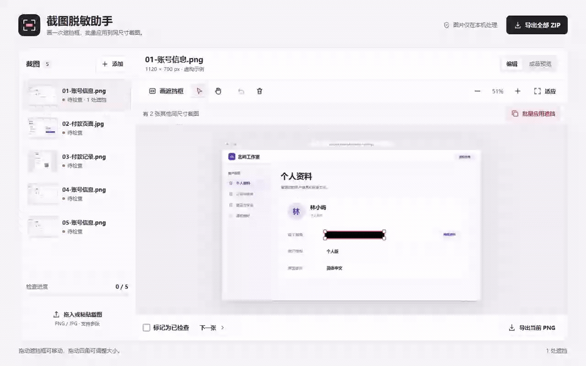
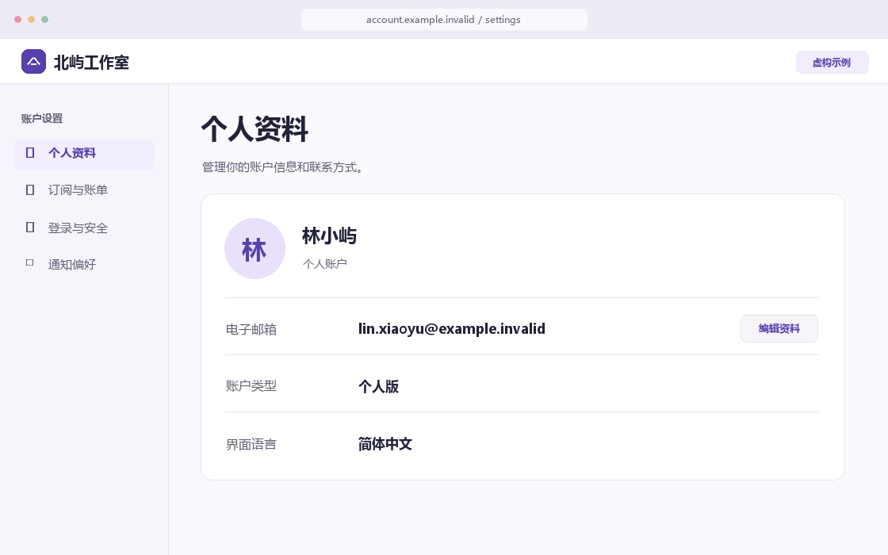
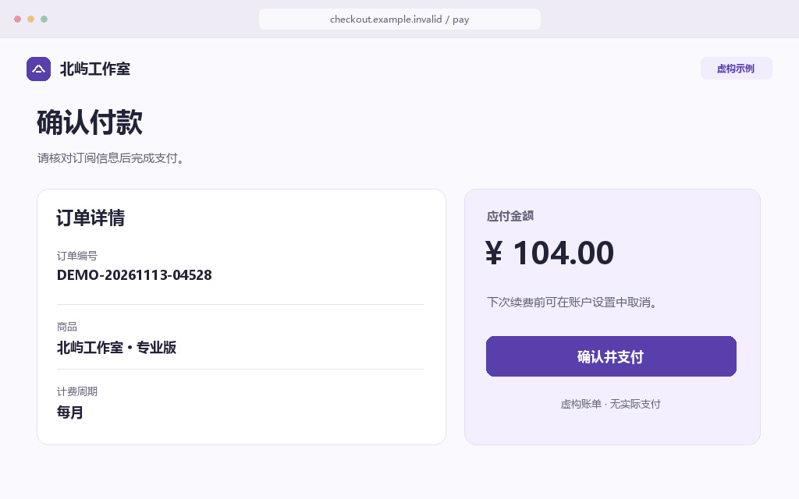
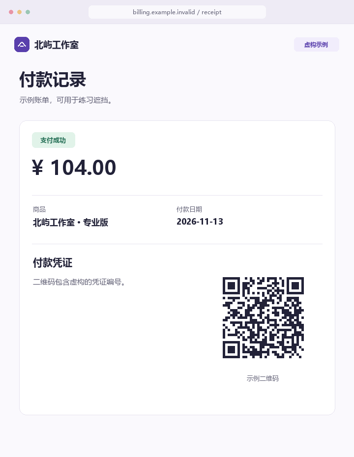

# 截图脱敏助手

把教程截图中的邮箱、订单号和二维码遮住，逐张检查后按顺序导出。图片只在浏览器里处理，无需注册或上传。

**[打开在线演示](https://ttt759.github.io/screenshot-redactor/)** · [下载最新版本](https://github.com/ttt759/screenshot-redactor/releases/latest)

最新版本的「Assets」提供 Windows x64 安装包（EXE）和完整程序压缩包（ZIP）。安装版可从开始菜单打开，更新时运行新版安装包。ZIP 解压后双击 `ScreenshotRedactor.exe` 即可使用。两种版本都复用系统的 Microsoft Edge WebView2 运行时，支持离线导入、编辑和导出。缺少运行时的电脑首次打开时会提示前往微软下载页。



## 使用方式

1. 打开后是空白工作区。拖入多张静态 PNG 或 JPG，点击「选择图片」，或用 `Ctrl/⌘ + V` 粘贴截图。选中左侧截图后可用上下按钮调整顺序，或从批次移除该图。
2. 用「画遮挡框」拖出黑块。选中黑块可移动、拖动四角调整大小、删除或撤销。在画布上按住 `Ctrl/⌘` 滚动鼠标可围绕光标缩放图片，按住空格拖动可临时平移。按 `0` 看原图像素，点「适应」可看全图。
3. 点击「批量应用遮挡」，勾选要复制的框和同尺寸、同布局的截图。复制后的框可独立调整。点「撤销整批」可以撤销最近一次批量应用，保留其他编辑。
4. 点击「开始检查」进入成品预览，检查覆盖范围后点「确认并继续」，即可跳到下一张待检查的截图。修改过的截图会重新标为待检查。导出提醒里的文件名可以直接点开检查。
5. 导出当前 PNG，或将列表里的截图打成 ZIP。ZIP 内从 `01-redacted.png` 开始按列表顺序命名。

导出会按原图显示尺寸重绘 PNG，把不透明的纯黑像素直接写进成品。源文件保留在原处，编辑记录在当前页面会话中保存，刷新页面会清除当前批次。

快捷键 `W` 上一张、`S` 下一张、`R` 画遮挡框。在成品预览中按 `E` 确认当前图并跳到下一张待检查图。

## 示例素材

在空白工作区点「加载虚构示例」可试用五张截图。第一张账号图已遮住姓名和邮箱，可以直接把这两个框应用到另外两张同尺寸的账号图。

| [账号信息](docs/samples/account.png) | [付款页面](docs/samples/checkout.jpg) | [付款记录](docs/samples/receipt.png) |
| --- | --- | --- |
|  |  |  |

## 本地运行

下载仓库后，在项目目录运行 `npm start`，然后打开 [本地页面](http://127.0.0.1:5173/)。运行网页无需安装依赖。`docs/` 是完整的静态站点，可直接作为 GitHub Pages 发布目录。

## 验证

```sh
npm ci
npm test
npx playwright install chromium
npm run test:e2e
```

浏览器验收会一次拖入 10 张混合尺寸的 PNG/JPG，在其中三张遮住邮箱、订单号和二维码，逐张预览确认后下载 ZIP。测试会解压并检查顺序、尺寸、黑块像素，以及导出图片与成品预览逐像素一致。

在 Windows x64 上可运行 `npm run package:win`，EXE 和完整程序 ZIP 输出到 `release/lightweight/`，再用 `npm run test:desktop` 验证打包结果。GitHub 发布时会构建并附上缺少的下载文件。

ZIP 由本地打包的 [fflate](https://github.com/101arrowz/fflate) 生成。第三方许可见 [fflate.LICENSE.txt](docs/vendor/fflate.LICENSE.txt)。
